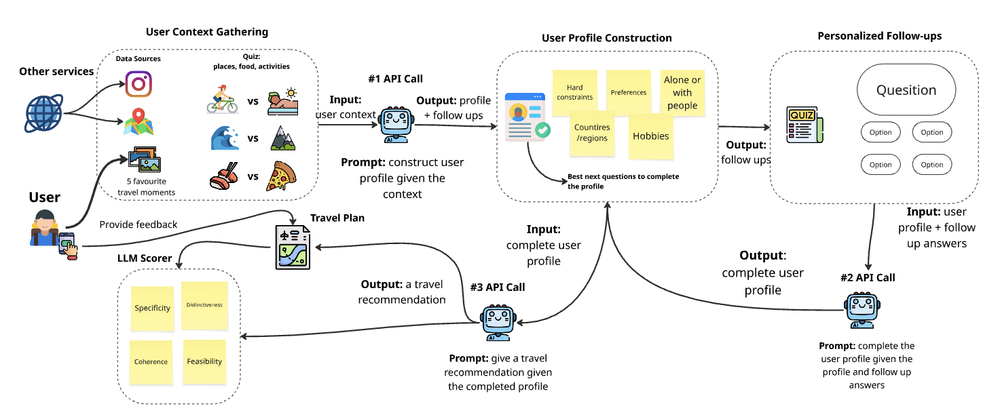

# Place & Purpose: AI Onboarding for Personalised Travel (Proof of Concept)

> Skip the questionnaire. Read the traveller from photos, swipes and five smart questions.
> Built at the AI Summer School 2026 (HES-SO / Swiss AI Center) for Place & Purpose.

**[Try the live prototype](https://claude.ai/public/artifacts/9890bf0c-845c-48de-9b08-9c9fbd184b37)** | [Full paper (PDF)](docs/paper.pdf)

**Status:** proof of concept. It shows the onboarding idea works and where the risks are. It is not a production product.

## The business problem

Travel planning today means a dozen browser tabs or generic "top 10" lists that read the same for everyone. The obvious fix is to ask the traveller about their taste, but that backfires: a form long enough to build a useful profile is long enough to make people leave. People are also bad at describing their own taste in the abstract.

**Why it matters commercially:** the first suggestion has to already feel personal. If onboarding loses the user, nothing else in the product gets a chance.

## Who it is for

| Segment | What they want | Role in go-to-market |
|---|---|---|
| **Hotels** | A guest experience better than a printed list of nearby restaurants | Earlier adopter, pilots a concierge feature |
| **Individual travellers** | Suggestions that feel personal, not like a search engine | Second wave, especially people already happy to let an AI handle small decisions |

## The idea in one line

Ask less, read more. Collect signal the traveller already carries instead of making them type it.

1. **Consent per data source** (photos, Instagram, Google), so each permission has one explainable use
2. **Account linking**, which decides Scenario A (no public social profile) or Scenario B (public profile)
3. **Five photos from past trips**: what they did, not what they say they like
4. **Pairwise preference swipe**: places, food, activities
5. **Short adaptive questionnaire**: only closes the gaps (diet, budget, mobility, companions, time windows)

Every suggestion comes with the reason behind it, so the traveller sees why it fits them.

## How the POC works

Read the diagram left to right:

1. **Gather context.** The user provides five favourite travel moments (photos) and plays a quick "this or that" quiz on places, food and activities. In Scenario B, other services such as Instagram add more signal.
2. **Call 1: build the profile.** The model turns that raw context into a first profile (hard constraints, preferences, alone or with people, countries/regions, hobbies) and decides which questions would fill the biggest gaps.
3. **Personalised follow-ups.** The user answers a handful of multiple-choice questions, chosen for them rather than from a fixed form.
4. **Call 2: complete the profile.** The model merges the answers into the final profile.
5. **Call 3: recommend.** The model produces a travel plan from the completed profile.
6. **Score and learn.** An LLM scorer rates the plan on specificity, coherence, feasibility and distinctiveness. User feedback on the plan is the planned next step, not yet part of the POC.

The three calls use the same model (Claude Sonnet 4.6) and the same settings in every test, so any difference in results comes from the profile, not the model. Technical details are in the [paper](docs/paper.pdf).

## What the POC proves

| Question | Answer from the POC |
|---|---|
| Can onboarding be fast? | Yes: **3 min 21 s** on average, excluding model latency |
| Do testers like the flow? | Yes: **78%** overall UX score (3 testers), ease of use **10/10** |
| Can a model read useful signal from photos? | Yes: it identified a Moroccan riad from architecture alone and inferred winter sports from visible ski gear |
| Does social media data improve results? | **A bit, depending on the task** (see below) |
| Do users trust it with their data? | **Not yet**: privacy comfort was the weakest score (60%) |

## The key decision: Scenario A or B?

This is the real business question the POC was built to inform.

| | **A: no social media** | **B: with public social profile** |
|---|---|---|
| Signals | Photos, swipes, questions | Same, plus social media posts |
| Legal risk | Low, consent-based | Higher, only via official platform APIs |
| Engineering effort | Low | Higher, needs a platform developer review |
| Quality depends on | What the user chooses to upload | A richer, continuously growing signal |
| Deployable by a Swiss company | Today | Only after platform approval |

**What we measured** (LLM judge, blind scoring plus a check for contradictions with the profile):

| Task | Blind score A / B (out of 5) | Contradictions A / B |
|---|---|---|
| 7-day trip | 4.25 / 4.75 | 3 / 2 |
| 3-hour Lausanne outing | 3.5 / 2.75 | 2 / 1 |

**Reading it as a decision-maker:** social data gives a modest, task-dependent gain. The quality edge appeared on the longer trip but not the short one. Fewer contradictions with the traveller's profile showed up in both. Testers also noticed that follow-up questions felt more personal under B. The test was deliberately conservative (five hand-picked screenshots, not a connected profile), so the real gap could be larger. With 3 testers, it is a signal, not proof.

**Our recommendation:** launch with Scenario A, treat B as an upgrade path once the pilot shows that the extra personalisation is worth the legal and engineering overhead.

## Privacy and compliance as a business constraint

- **Scenario A:** low risk under GDPR and the Swiss nFADP, based on direct, informed consent.
- **Scenario B:** official platform API only. Scraping is not a legal option, whatever the personalisation gain.
- **LLM provider:** photos leave Switzerland/EU for the provider's servers. Covered by a DPA with Standard Contractual Clauses. Users are told in-app before upload. Not used for training by default.
- **Sensitive inferences:** the profile schema excludes special-category data (religion, health, orientation, political views) by design. No facial recognition.

Since privacy trust scored lowest with no variation between testers, this is a product problem as much as a legal one. It needs clearer messaging and probably a visible "what we use and why" screen.

## From POC to MVP

| Step | What it unlocks |
|---|---|
| Pilot with 1 to 2 hotels | Real users, real photos, real feedback instead of 3 authors |
| Thumbs up/down on every suggestion | Cheapest direct quality signal, closes the feedback loop in the diagram |
| Privacy-trust screen in onboarding | Attacks the weakest metric |
| Maps and real routes | Moves from text itinerary to something usable on the ground |
| Itinerary builder, voice-note input | Lower friction, more complete planning |
| Official social API integration (Scenario B) | Only if the pilot justifies it |

**Proposed pilot metrics** (not yet measured): onboarding completion rate, time to first suggestion, thumbs-up rate, return usage.

## Known limitations

- 3 testers who are also the authors, with hand-picked photos
- The model infers too categorically from thin evidence (one solo photo became "prefers solo travel")
- LLM-judge scores are indicative, not a substitute for real user studies
- The prototype runs as a hosted demo, not a deployed product

## Team

Rafael Cardoso, Artemii Ponomarenko, Almira Birchmeier. Case study by Nataliia Molchanova (Place & Purpose) and Diego Fraile (HEIA-FR).

## License

MIT
